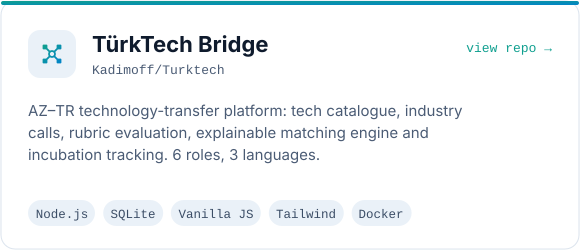
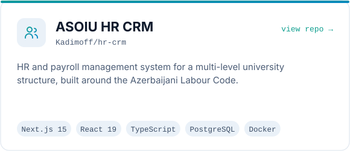
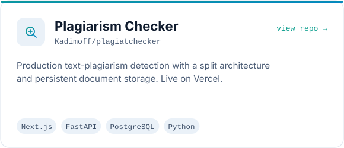
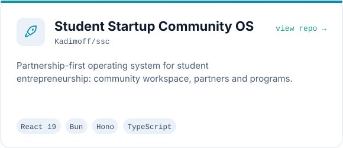
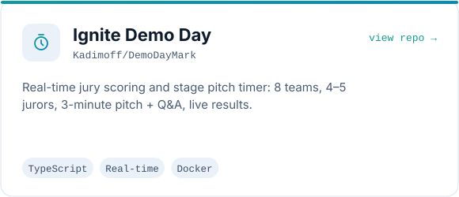
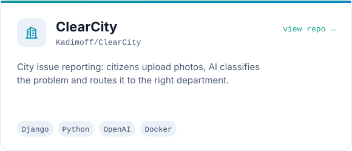

<picture>
  <source media="(prefers-color-scheme: dark)" srcset="https://raw.githubusercontent.com/Kadimoff/Kadimoff/main/dark.svg" />
  <source media="(prefers-color-scheme: light)" srcset="https://raw.githubusercontent.com/Kadimoff/Kadimoff/main/light.svg" />
  
</picture>

 

<picture>
  <source media="(prefers-color-scheme: dark)" srcset="https://streak-stats.demolab.com/?user=Kadimoff&hide_border=true&background=0B1220&stroke=2DD4BF&ring=F59E0B&fire=F59E0B&currStreakLabel=2DD4BF&sideLabels=9FB3D1&currStreakNum=E6EDF7&sideNums=E6EDF7&dates=55657F&card_width=1180" />
  <source media="(prefers-color-scheme: light)" srcset="https://streak-stats.demolab.com/?user=Kadimoff&hide_border=true&background=FFFFFF&stroke=0F9F8F&ring=D97706&fire=D97706&currStreakLabel=0F9F8F&sideLabels=0F1B2D&currStreakNum=0F1B2D&sideNums=0F1B2D&dates=8A98AD&card_width=1180" />
  
</picture>

 

<picture>
  <source media="(prefers-color-scheme: dark)" srcset="https://raw.githubusercontent.com/Kadimoff/Kadimoff/output/stats-dark.svg" />
  
</picture>
<picture>
  <source media="(prefers-color-scheme: dark)" srcset="https://raw.githubusercontent.com/Kadimoff/Kadimoff/output/langs-dark.svg" />
  
</picture>

<picture>
  <source media="(prefers-color-scheme: dark)" srcset="https://raw.githubusercontent.com/Kadimoff/Kadimoff/main/output/github-snake-dark.svg" />
  <source media="(prefers-color-scheme: light)" srcset="https://raw.githubusercontent.com/Kadimoff/Kadimoff/main/output/github-snake.svg" />
  
</picture>

 

## ⚡ About Me

I'm an **AI & Digital Technologies Specialist** and **Startup & Technology Transfer Office Lead Specialist** at **Azerbaijan State Oil and Industry University (ASOIU)** in Baku. I build AI-powered workflows and production web platforms, run my own servers, and help startup teams turn ideas into working MVPs.

🚀 Supported <strong>10+ startup teams</strong> in MVP planning, technical direction and business models

🧠 Working with <strong>LLMs, AI agents, local models (Ollama)</strong>, prompt engineering and workflow automation

🛠️ Shipping full-stack systems with <strong>Next.js, React, Node.js, Python (Django / FastAPI)</strong> and PostgreSQL

🐧 Comfortable on <strong>Linux, Docker and VPS / root servers</strong> — hosting, DNS, deployment

🎓 AI/ML mentor — <strong>30+ students</strong> mentored across Deep Tech, Ignite, SABAH.HUB and Bach Khoa Innovation 2026 (Vietnam)

🌍 Based in Baku · speaks Azerbaijani, Turkish and English

 

## 🧰 Tech Stack

 

## 🚀 Featured Projects

<table>
<tr>
<td width="50%" valign="top" align="center">
<a href="https://github.com/Kadimoff/Turktech">
<picture>
  <source media="(prefers-color-scheme: dark)" srcset="https://raw.githubusercontent.com/Kadimoff/Kadimoff/main/assets/turktech-dark.svg" />
  <source media="(prefers-color-scheme: light)" srcset="https://raw.githubusercontent.com/Kadimoff/Kadimoff/main/assets/turktech-light.svg" />
  
</picture>
</a>
</td>
<td width="50%" valign="top" align="center">
<a href="https://github.com/Kadimoff/hr-crm">
<picture>
  <source media="(prefers-color-scheme: dark)" srcset="https://raw.githubusercontent.com/Kadimoff/Kadimoff/main/assets/hr-crm-dark.svg" />
  <source media="(prefers-color-scheme: light)" srcset="https://raw.githubusercontent.com/Kadimoff/Kadimoff/main/assets/hr-crm-light.svg" />
  
</picture>
</a>
</td>
</tr>
<tr>
<td width="50%" valign="top" align="center">
<a href="https://github.com/Kadimoff/plagiatchecker">
<picture>
  <source media="(prefers-color-scheme: dark)" srcset="https://raw.githubusercontent.com/Kadimoff/Kadimoff/main/assets/plagiatchecker-dark.svg" />
  <source media="(prefers-color-scheme: light)" srcset="https://raw.githubusercontent.com/Kadimoff/Kadimoff/main/assets/plagiatchecker-light.svg" />
  
</picture>
</a> <a href="https://plagiatchecker.vercel.app">live demo ↗</a>
</td>
<td width="50%" valign="top" align="center">
<a href="https://github.com/Kadimoff/ssc">
<picture>
  <source media="(prefers-color-scheme: dark)" srcset="https://raw.githubusercontent.com/Kadimoff/Kadimoff/main/assets/ssc-dark.svg" />
  <source media="(prefers-color-scheme: light)" srcset="https://raw.githubusercontent.com/Kadimoff/Kadimoff/main/assets/ssc-light.svg" />
  
</picture>
</a>
</td>
</tr>
<tr>
<td width="50%" valign="top" align="center">
<a href="https://github.com/Kadimoff/DemoDayMark">
<picture>
  <source media="(prefers-color-scheme: dark)" srcset="https://raw.githubusercontent.com/Kadimoff/Kadimoff/main/assets/demodaymark-dark.svg" />
  <source media="(prefers-color-scheme: light)" srcset="https://raw.githubusercontent.com/Kadimoff/Kadimoff/main/assets/demodaymark-light.svg" />
  
</picture>
</a>
</td>
<td width="50%" valign="top" align="center">
<a href="https://github.com/Kadimoff/ClearCity">
<picture>
  <source media="(prefers-color-scheme: dark)" srcset="https://raw.githubusercontent.com/Kadimoff/Kadimoff/main/assets/clearcity-dark.svg" />
  <source media="(prefers-color-scheme: light)" srcset="https://raw.githubusercontent.com/Kadimoff/Kadimoff/main/assets/clearcity-light.svg" />
  
</picture>
</a>
</td>
</tr>
</table>

 

## 🧭 Mentorship & Programs

| Program | Role | |
|---|---|---|
| **Deep Tech Incubation** — ASOIU & IRIA | Deep Tech Mentor | 30+ students · AI tools, validation, prototyping |
| **Ignite** — ASOIU Startup & TTO | AI/ML Mentor | 15+ participants · AI workflows to MVP |
| **SABAH.HUB** — ASOIU Startup & TTO | AI/ML Mentor | AI tool selection, automation, MVP design |
| **IDEALISE-1 / IDEALISE-2** — ASOIU Startup & TTO | Project Coordinator | 25+ startup teams through incubation |
| **Bach Khoa Innovation 2026** — HCMUT, Vietnam | Mentor | International innovation program |
| **CyberBridge · Future-Fem · Sustainable City Hackathon** | Coordinator / Mentor | 110+ participants in total |

 

&nbsp;&nbsp;

